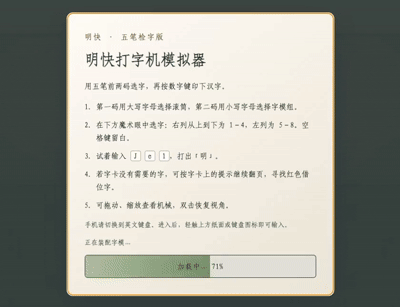

# 明快打字机模拟器

https://jincheng-yang.github.io/mingkwai/

[使用说明](#使用说明)

## 简介

此网页模拟器模拟了明快打字机的工作原理，但并非使用上下形检字法，而是使用五笔或双拼的前两码检字。

[明快打字机](https://zh.wikipedia.org/zh-cn/中文打字機#明快)由中国作家、语言学家林语堂先生发明，用仅比英文打字机略大的规模，实现了全机械结构的中文打字机。其核心思想中包含两方面的创新，硬件上林语堂设计了三级滚筒来排布数万汉字，检字上林语堂首创了上下形检字法，并引入“魔术眼”方便检索与确认。十分可惜的是，由于其复杂的结构，并没有实现量产。

[明快打字机](https://zh.wikipedia.org/zh-cn/中文打字機#明快)的大型滚筒上装有6个中型滚筒，每个中型滚筒有6个小型滚筒，每个小滚筒有8个面，每个面有28个字模。其示意图如下。

上下形检字法有36个上形，对应于6*6个滚筒；28个下形，对应28个字模组；每组8个字模在小滚筒的8个面上，同时显示在魔术眼中，由数字键1-8决定键入哪一个。

虽然其专利文件被完整保留，但目前还未有人能够复刻。近日，唯一的原型机疑似被发现，为重制带来新的希望。

本网页用于模拟魔术眼的工作原理。为降低学习曲线，使用[五笔字型输入法](https://zh.wikipedia.org/wiki/五笔字型输入法#新世纪版)来实现检字。

本模拟器支持新世纪、86版和98版五笔，以及小鹤、微软和智能ABC双拼，可在加载画面选择。希望此模拟器能够在明快打字机重制之后，为上下形检字法提供大家习惯的替代检字法。

本模拟器当前字表收录了GB2312的6763个汉字。

## 使用说明

此模拟器包含6*6个滚筒；每个滚筒有28个字模组和每组8个候选字，共288个字模面。使用时：

输入 `GFDSA! HJKLM@ TREWQ# YUIOP$ NBVCX% ^&*()Z` 中的字符将选出对应的中型滚筒和小型滚筒。常规大写字母是所选方案编码的第一个字母；其余位置可按字卡提示翻页。

输入 `qaz wsx edc rfv tgb yhn ujm ik 9ol 0p` 中的小写字母或数字将选出对应的字模组。字母对应所选方案的第二码，未被方案使用的列键用于额外字模组。微软双拼用分号 `;` 输入韵母 `ing`，该方案的分号列取代 `9` 列。

这时将可以在**魔术眼**看到对应编码的候选字。键入数字1-8来选择对应汉字,编号自上而下。

新世纪五笔示例：

|字|代码|
|--|---|
|明|Je1|
|快|Nn5|
|打|Rs1|
|字|Pb1|
|机|Sw1|

**特殊情形**

* 如果字的简码只有一个字母（如`我`的简码是`q`）则第二个字母使用同一个选项（`我`的代码是`Qq1`）。

**关于翻页**

* 有一定机率以某两个字母开头的五笔简码包含不只8个常用汉字。如果魔术眼的8个字不含想输入的字，需要**翻页**。
* `翻页代码`写在魔术眼8个候选字的下方。如若还没有想要的字就需要继续翻页。
* 借住的字用红色字体表示。

## 开发数据

每个输入方案位于独立的 `dev/<mode>/` 目录，包含生成脚本、编码 CSV 和导出的字卡及滚筒数据。
通用字表是 `dev/gb2312.txt`，字表与字频的原始数据位于 `dev/gb2312/`。

| mode | 输入方案 | 生成脚本 |
|---|---|---|
| `wubi-06` | 新世纪五笔 | `dev/wubi-06/generate_wubi-06.py` |
| `wubi-86` | 86版五笔 | `dev/wubi-86/generate_wubi-86.py` |
| `wubi-98` | 98版五笔 | `dev/wubi-98/generate_wubi-98.py` |
| `shuangpin-xiaohe` | 小鹤双拼 | `dev/shuangpin-xiaohe/generate_shuangpin-xiaohe.py` |
| `shuangpin-microsoft` | 微软双拼 | `dev/shuangpin-microsoft/generate_shuangpin-microsoft.py` |
| `shuangpin-abc` | 智能ABC双拼 | `dev/shuangpin-abc/generate_shuangpin-abc.py` |

用 Python 运行对应脚本，输出为 `dev/<mode>/<mode>-code.csv`，只有 `char`、`key1`、`key2` 三列，
按通用字表顺序排列。第一键大写，第二键小写或方案符号；五笔的单字母简码重复该字母。
这些脚本只生成编码，不分配字卡或翻页位置。双拼脚本保留不同读音的编码，使用
`dev/gb2312/zipin.csv` 和补充读音依赖 `pypinyin==0.55.0`。

随后从 `dev/` 运行通用 [mingkuai.ipynb](dev/mingkuai.ipynb)，将 `mode` 设为表中的方案名并执行所有单元。
Notebook 保留当前每字取第一条编码的规则，生成 `<mode>.csv` 字卡和 `<mode>.txt` 滚筒字模。
微软双拼会保留真实的 `;` 键，同时维持36张卡、每卡28列的结构。
若贪心分配没有直接可用的格子，会尝试经过一个中间格的两次单键翻页；导出前检查候选上限，避免截断汉字。
86版和98版五笔的上游来源、固定版本与授权说明分别记录在对应目录的 `SOURCE.txt` 和许可证文件中。

## 参考资料与拓展

1. 新世纪五笔码表：https://06wb.github.io
2. 字频排序：https://lingua.mtsu.edu/chinese-computing/statistics/char/list.php?Which=TO
3. GB2312字库：https://github.com/beifeng600/nlp_storeroom/blob/master/dict/zh/character%20set/GB2312汉字表_6763.txt
4. 明快打字机专利：https://patents.google.com/patent/US2613795A/en
5. 科普视频：[在打字机时代，我们要怎么打出汉字【差评君】](https://www.bilibili.com/video/BV1eM4y1w7JF/)
6. 复刻带有电机的版本：[【何同学】我们做了一个中文打字机...](https://www.youtube.com/watch?v=yNoWMaOyWHY)
7. 其他尝试：https://github.com/divertingPan/mingkwai-typewriter
8. 86版五笔码表：[Rime 五笔字型](https://github.com/rime/rime-wubi/blob/152a0d3f3efe40cae216d1e3b338242446848d07/wubi86.dict.yaml)，采用 LGPLv3；固定版本及提取方式见 [来源说明](dev/wubi-86/SOURCE.txt)。
9. 98版五笔码表：[98五笔小组单字表](https://github.com/yanhuacuo/98wubi-tables/blob/6b8b6fb9d3c34e0d5e3b17211e1f1c100e7eb697/98%E4%BA%94%E7%AC%94%E5%8D%95%E5%AD%97%E8%A1%A8-%E3%80%90%E5%8D%95%E4%B9%89%E3%80%91.txt)，采用 Unlicense；固定版本及提取方式见 [来源说明](dev/wubi-98/SOURCE.txt)。
10. 小鹤双拼：[小鹤官网](https://flypy.cc/)、[Rime 小鹤双拼键位定义](https://github.com/rime/rime-double-pinyin/blob/master/double_pinyin_flypy.schema.yaml)。
11. 微软双拼：[Rime 微软双拼键位定义](https://github.com/rime/rime-double-pinyin/blob/master/double_pinyin_mspy.schema.yaml)。
12. 智能ABC双拼：[Rime 智能ABC双拼键位定义](https://github.com/rime/rime-double-pinyin/blob/master/double_pinyin_abc.schema.yaml)。
13. 缺失拼音补充：[pypinyin](https://github.com/mozillazg/python-pinyin)，用于为字频表未提供有效读音的汉字补充拼音。
